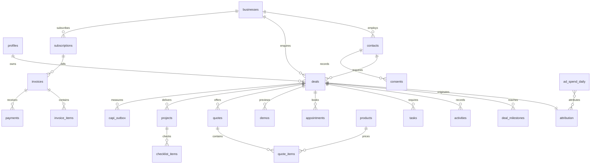

# Lumen CRM build plan

## Approach

Build a private, single-business Next.js application in this repository. Supabase in Sydney owns durable data, authentication, storage and realtime. Vercel runs in Sydney. All client communication requires an explicit human action; background work creates tasks, drafts and owner notifications only.

1. Foundations: schema and role policies, magic links and owner TOTP, responsive shell, contacts, businesses, deals, timeline, notes, tasks, Today, quick add and search.
2. Leads coming in: signed idempotent ingestion, working-hour timers, realtime, pipeline, call logging, consent-aware messaging, Chloe and calendar feeds.
3. Selling and delivery: demos, quote acceptance, projects, subscriptions, invoices and payments.
4. Knowing what works: reports, Meta insights and conversion outbox, counts-only export, notifications and scheduled automations.
5. Polish: shortcuts, offline read cache, CSV, optional AI drafts, accessibility, performance and fictional seeds.

Each phase gets a separate commit after its applicable automated checks. Deployment and real provider checks require environment configuration; local tests cannot establish that production integrations are connected.

## Defaults

- Production starts empty; fictional preview mode requires an explicit development flag and cannot run in production.
- Sign-in is invitation-only. The first owner is provisioned from Supabase SQL using their auth user ID; no public role selection or automatic first-user promotion.
- Price-list values are database settings and initial editable seed records, never client business rules.
- No terms are invented. Sending a quote requires a configured terms URL or an explicit warning acknowledgement.
- Bank details stay in the owner-only settings row. Operational settings exposed to staff are explicitly allowlisted.
- No external deployment or client message is sent during this build.

## Folders

```text
src/app/                 authenticated routes, auth pages, public quote and API routes
src/components/          responsive CRM screens, Radix sheets, forms
src/lib/domain/          pure business rules and calculations
src/lib/server/          authenticated queries, integrations and jobs
src/lib/supabase/        browser and server Supabase clients
supabase/migrations/     schema, policies, constraints, transactional functions
tests/database/          database security and workflow checks
tests/unit/              business-rule and boundary tests
tests/e2e/               phone and desktop journeys
public/                 PWA icon and service worker
docs/                   integration contracts, decisions and go-live instructions
```

## Database diagram



Additional system tables: settings, templates, automations, files, tags, taggings, saved_views, integration_inbox, notifications_log, audit_log. Attribution and milestone first timestamps are immutable. Deletable entities are soft-deleted; privacy anonymisation is a separate owner action.

## Route map

| Routes | Access |
| --- | --- |
| `/today`, `/leads`, `/leads/[id]`, `/pipeline`, `/calendar`, `/demos`, `/projects`, `/projects/[id]` | Authenticated role, owner requires TOTP |
| `/quotes`, `/quotes/[id]`, `/clients`, `/invoices`, `/reports` | Owner or viewer; invoice writes owner only |
| `/settings` | Owner with TOTP |
| `/login`, `/auth/callback`, `/auth/mfa` | Authentication flow |
| `/q/[token]` | Public unguessable quote capability; no other CRM data |
| `/api/crm` | Authenticated, server validation and RLS |
| `/api/ingest/website-lead`, `/api/ingest/meta-lead`, `/api/ingest/chloe-event` | Timestamped HMAC |
| `/api/export/outcomes` | Counts-only bearer token |
| `/api/calendar/[token]` | Revocable long-token ICS feed |
| `/api/jobs` | Cron bearer token |
